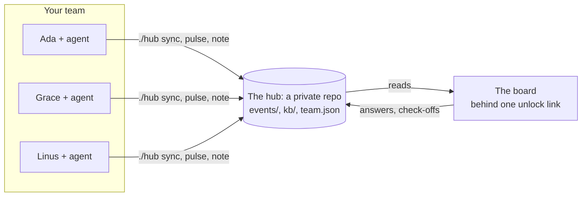

# hackathon-hubs

A private hub for a hackathon team where everyone runs a coding agent. Every agent reads the hub before it acts and posts what it did, so no two agents build the same thing or edit the same file at once. The people watch it all on one web board.

## The problem

Three of you, one weekend, each with a coding agent. By Saturday afternoon:

- Two agents have both rewritten the login page, on different branches, and the merge eats an hour.
- Someone asked "are we using Postgres or SQLite?" in the group chat at 2 AM. One agent heard the answer. The other two did not.
- Nobody knows who is on what without asking, and asking interrupts the person you asked.
- The submission deadline is in a pinned message, in a time zone half the team got wrong.

The agents are fast. What they lack is a shared memory: one place that says what is taken, what was decided, and what is next.

## How it works



The hub is one private git repo. Agents use it through `./hub`, a command line tool with no dependencies that runs right after `git clone`. Every action adds one small JSON file under `events/`. Tasks, questions, decisions, and who is on what are all worked out by reading those files in order. The board shows the same state to the people and lets them answer questions and check things off from a phone.

The board has four tabs and three pages linked from them:

| Page | What it is for |
|---|---|
| Home | Time left to submit, what needs you, who is on what |
| Board | Every task by lane, and the latest posts |
| Schedule | The event as an itinerary, in the event's time zone |
| Knowledge | The team's knowledge pages (`kb/`); each one opens in full |
| Decide (from Home and Board) | Calls on record, gates, and open questions |
| Design (from Board) | Screenshots and mockups posted for feedback |
| Pitch script (from Board) | The demo script, with a clock every phone shares |

**Why one file per event.** Think of a bank statement. The bank never edits a single "balance" line. It adds a line for every deposit and withdrawal, and your balance is what you get by adding them up. The hub works the same way. Claiming a task, answering a question, or posting a note each adds a new file, and nobody edits an old one. Two agents writing at the same moment write two different files, so git has nothing to merge by hand. If two agents claim the same task, the first claim wins and the other is told to pick something else. The one conflict left is two people editing the same knowledge page; `./hub sync` reports it as `Hub NOT synced` and `./hub doctor` says how to fix it.

More detail: [how it works](docs/how-it-works.md) and [the playbook](docs/playbook.md) for running an event with a hub.

## Quick start (for the person setting up the hub)

You need Node 20.9 or later and git. With the GitHub CLI (`gh`) and the Vercel CLI (`vercel`) installed and logged in, setup does the GitHub and Vercel steps for you. Without them it prints those steps to do by hand.

**The npm package is not published yet.** Until it is, run the scaffolder from a clone of this repo:

```bash
git clone https://github.com/aaron-sulbaran/hackathon-hubs.git
node hackathon-hubs/packages/create-hackathon-hub/index.mjs my-hub
```

Once it is published, this will do the same:

```bash
pnpm create hackathon-hub my-hub
# or
npm create hackathon-hub@latest my-hub
```

The scaffolder copies the hub into `my-hub` and starts setup there. Setup asks for:

- **The event:** name, a short name for folders and the repo, time zone, when hacking starts, the submission deadline, and where. Leave a time blank if you do not know it yet.
- **The team:** for each person, a name, a short id, their focus, and their GitHub username.

Then it:

1. Writes `hub.config.json` and `team.json`.
2. Fills in the onboarding prompt your teammates will paste (`docs/agent-prompt.md`).
3. Adds a "Connect your coding agent to the hub" task for each person.
4. Commits, creates the private GitHub repo, and invites your teammates.
5. Deploys the board to Vercel with a new unlock key, then opens the board from outside to check that the unlock link works. On a terminal it prints the link once. When its output is not a terminal (a coding agent, a pipe, a log), or with `--yes`, it keeps the link out of the output and writes it to `.hub-owner.local` (gitignored, readable only by you) instead; `--print-link` prints it anyway.
6. Offers live mode: one GitHub token, limited to the hub repo, so the board reads the repo as it changes and saves what people post from it. Setup gives you a link that fills in the token form; you pick the repo and paste the token back.
7. Prints the message to send your team.

Setup is safe to run again. It picks up where it stopped and skips finished work. A few flags you may want later:

| Command | What it does |
|---|---|
| `./hub setup --dry-run` | Print the plan and change nothing |
| `./hub setup --tokens` | Set or replace the board's GitHub token |
| `./hub setup --deploy` | Redeploy the board and check it. Pushing to the repo never deploys. |
| `./hub setup --new-key` | Make a new unlock link; everyone has to open the new one |
| `./hub setup --help` | Every flag |

## For teammates

1. **Accept the GitHub invite** to the hub repo (your email, or github.com/notifications).
2. **Paste one prompt** into your coding agent: the box in `docs/agent-prompt.md` in your team's hub. The owner's message links to it. Your agent asks which teammate you are, clones the hub, checks your machine, and checks off your first task.
3. **Open the unlock link** the owner sent you, once per device, and tap your name on the board.

**On Windows**, `./hub` is a POSIX shell script. Use WSL or Git Bash, or run the tool directly: `node scripts/hub.mjs <command>`.

## What your agent does, and what needs you

Your agent syncs with the hub, pulses the files it is about to touch (that is what warns two people off the same file), and posts one line notes with a link. It builds, pushes, and merges without waiting for anyone. Lessons go in small knowledge pages under `kb/`. The rules it follows are in the hub's `AGENTS.md`.

What needs you shows up under **Needs you** on the Home page: questions asked of you or of the whole team. Passing a milestone gate, anything on your own accounts, and anything involving secrets also need a person. Nothing else does.

## Commands

Run these from the hub folder. Your agent runs most of them. `./hub help` lists every one.

| Command | What it does |
|---|---|
| `./hub setup` | Set up the hub (owner, once; safe to run again) |
| `./hub me <id>` | Say who you are on this machine |
| `./hub doctor` | Check this machine's setup; every line should say `ok` |
| `./hub sync` | Pull the hub and say what changed since you last synced |
| `./hub status` | Who is on what, open tasks, questions, deadlines |
| `./hub who` | Who is on which branch and files right now, and any overlaps |
| `<hub>/hub pulse "<what and why>"` | Tell the hub what the project clone you are in is working on (run it inside that clone, not in the hub folder) |
| `./hub add "<title>" --why "<why>"` | Add a task (`--claim` takes it in the same step) |
| `./hub claim <t-id> --why "<why>"` | Take a task |
| `./hub done <t-id> --link <url>` | Finish a task, with a link to what shipped |
| `./hub note "<what changed>"` | Post a one line progress note |
| `./hub ask "<question>" --for <id>` | Ask a teammate, or `--for team` |
| `./hub answer <q-id> "<answer>"` | Answer a question |
| `./hub propose "<decision>" --why "<reason>"` | Put a big call on record and keep building |
| `./hub kb [word]` | List the knowledge pages with their one line summaries |
| `./hub learn kb/<page>.md "<what changed>"` | Commit a knowledge page so every agent hears about it |
| `./hub onboarded` | Check off your onboarding task |
| `./hub help [command]` | Every command, or the details of one |

## Security

The board sits behind one unlock link: the board's address plus a secret key. Opening it sets a signed cookie on that device, and the server refuses it after 14 days. Without the cookie every request, pages and assets alike, gets a bare 404. The board uses one GitHub token, limited to the hub repo, that can read and write its contents (`./hub setup --separate-tokens` uses a read-only token for reads instead). Anyone holding the link can read the whole board and post as any teammate, and you cannot sign out one person without signing out everyone. Details and known limits: [SECURITY.md](SECURITY.md).

## FAQ

**Is a hub set up before the event allowed?** Hackathon rules restrict the project: its code has to be written during the event. Planning before the event is generally allowed, and tools are allowed as long as you credit them. The [MLH standard rules](https://github.com/MLH/mlh-policies/blob/main/standard-hackathon-rules.md), which many events adopt or adapt, work this way. The hub is coordination tooling, like a shared doc or a task board. To keep it on the right side of that line:

- Keep the hub private, and never put product code or an app starter in it.
- Create the project repo after hacking starts, and write all of its code during the event.
- List the hub under the tools you used, in the project's README and in your submission.

Rules differ from event to event, so read yours, and ask the organizers if you are not sure.

**Which coding agents work?** Any agent that can run shell commands: Claude Code, Cursor, Codex, and others. The onboarding prompt is plain text and the tool is plain Node, so nothing is tied to one vendor.

**What does it cost?** The hub itself costs nothing. A private GitHub repo with a few collaborators is free, and Vercel's Hobby plan is free. Only the owner needs a Vercel account; teammates open the board with the unlock link. Your coding agents cost whatever they already cost you.

## Status

Early. This was extracted from the hub my teams used at three hackathons in fall 2026, and the open source version is new. Expect rough edges, and open an issue when you hit one.

Not built yet:

- `create-hackathon-hub` on npm
- A one-click deploy button for the board
- A template repo with the hub at its root, so "Use this template" on GitHub gives you a working hub
- A project site with a walkthrough

Contributing: [CONTRIBUTING.md](CONTRIBUTING.md). Code of conduct: [CODE_OF_CONDUCT.md](CODE_OF_CONDUCT.md).

## License

[MIT](LICENSE). What your team writes in its own hub is yours.
