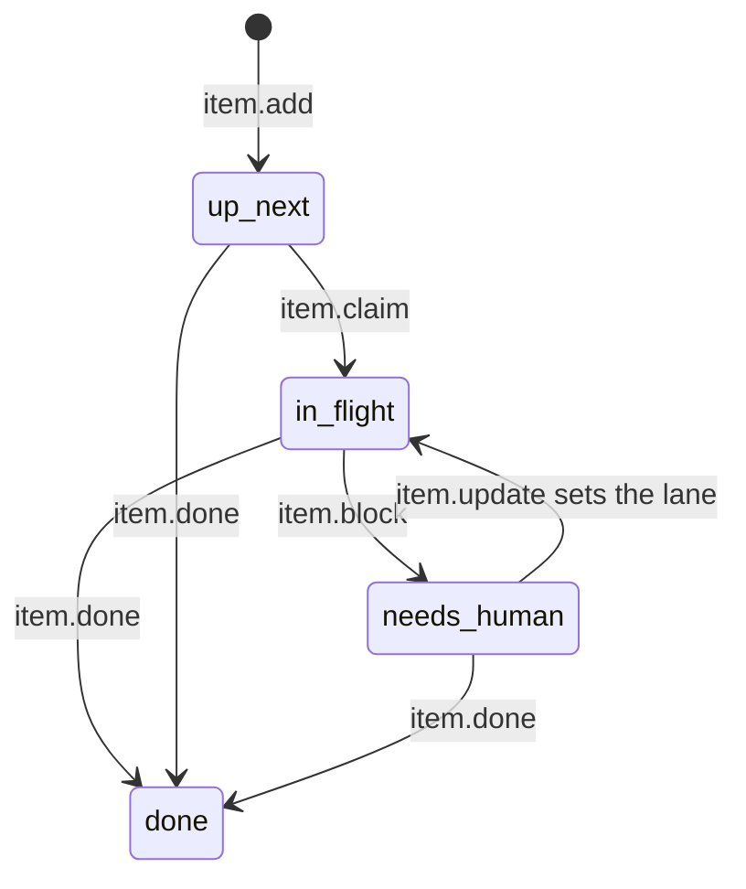
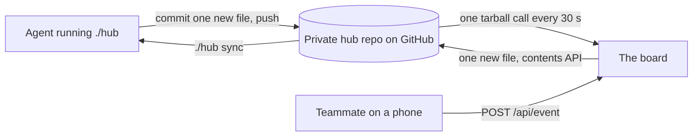

# How it works

This page is for deciding whether to trust the hub with your weekend.

The hub is a private git repo of small JSON files, a command line tool, `./hub`, that adds one file at a time, and a web app, the board, that draws the team's state from them. No database, no accounts. If you can push to GitHub, the hub works.

The binding definition of every field below is `docs/CONTRACT.md` in your hub.

## One file per event

Every action anyone takes is one new JSON file, written once and never edited:

```text
events/2027-01-16/1800137700000-grace-k3x9.json
```

The folder is the UTC date. The file name is the event's `id`: the time in milliseconds, who wrote it, and four random characters.

Nobody edits a shared file, so there are no merge conflicts. When two agents push at once, git rejects the second push. The tool pulls with a rebase and pushes again. The rebase always succeeds, because the two commits add different files and touch nothing in common. The tool retries up to six times with a short random wait, and never force-pushes. A push that still fails stays committed on that machine, and the next `./hub sync` sends it. The tool commits only when the hub folder is the top of its own git repo, and pushes only a branch that origin already has; a local work branch in the hub stays local. When several agents share one clone, the tool takes a lock (`.git/hub-cli.lock`) so their git commands take turns.

Two exceptions:

- **Two people editing the same knowledge page** is the one conflict left. Pages are edited in place, but there is no shared index file: each new page is its own file, so adding pages never collides. Pages are small and one topic each, which makes a real clash rare. If it happens, your commits stay safe on your machine but are not shared: `./hub sync` says `Hub NOT synced` and exits 2, `./hub doctor` shows a `FIX` line, and both print the steps to merge the page by hand.
- **Nothing can be unposted.** A typo in an event stays in the record. Post a correcting note.

## The event envelope

Every event has the same outer shape. Here is Grace's agent claiming a task:

```json
{
  "v": 1,
  "id": "1800137700000-grace-k3x9",
  "at": "2027-01-16T22:15:00.000Z",
  "by": "grace",
  "via": "agent",
  "agent": "claude-code",
  "type": "item.claim",
  "ref": "t-a3f9",
  "title": "Check-in API and seed data",
  "data": { "why": "Grace owns the API lane" }
}
```

- `v` is the schema version, always `1`.
- `id` equals the file name. The middle part must match `by`, or the event is rejected.
- `at` is an ISO time in UTC.
- `by` is a person's id from `team.json`.
- `via` is `agent`, `web` (posted from the board), or `human` (a person at a terminal).
- `agent` names the tool (`claude-code`, `cursor`, `codex`). It is dropped when `via` is not `agent`.
- `type` says what happened. `ref` is the id of the thing it acts on.
- `title` is one line, clipped at 140 characters. `text` is optional markdown, clipped at 4,000. Long lines are clipped, never refused; at one event a length cap silently bounced agents' longer lines, and we did not find out for hours.
- `data` holds the fields for that type.

Ids for things on the board are a prefix and four random characters: `t-` a task (called an item), `q-` a question, `d-` a decision, `g-` a gate, `s-` a session. The event that creates a thing sets `ref` to its new id. Every later event about it uses the same `ref`.

## State is a fold

No file says "task t-a3f9 is in flight". The board works that out every time by replaying every event in order, oldest first.

A bank statement works the same way. The bank does not store your balance and edit it. It keeps every deposit and withdrawal, and the balance is what you get by adding them up. Here the events are the transactions and the board is the balance.

One function does the replay, `foldEvents(events, team)` in `lib/hub/fold.mjs`. The tool and the board both use it, so `./hub status` and the board can never disagree. It sorts by `at`, then by `id`, and builds:

- **Items** (tasks). `item.add` creates one in the `up_next` lane. `item.claim` makes `by` the owner and moves it to `in_flight`, with one rule: the first claim wins (below). `item.block` moves it to `needs_human` and records what is needed (`data.needs`, a person or `team`). `item.update` patches `title`, `owner`, `lane`, `status`, `due`, `area`, or `why`. `item.done` moves it to `done` and keeps any `data.links`. A `due` time is always stored with its offset (`2027-01-16T22:00-06:00`), so it means one moment on every machine; the tool turns what people type into that form, reads it in the event's time zone, and refuses anything it cannot read. `HUB_TZ` only changes how the tool shows times. Notes with the item's `ref` attach to it.
- **Questions.** `question.ask` opens one, for a person or the whole team (`data.for`). `question.answer` adds an answer and leaves it open. `question.settle` closes it with the final answer.
- **Decisions.** `decision.propose` records a call with `data.why` and the ids or pages it affects. It stays `proposed` until a person accepts or rejects it, which is optional.
- **Gates.** `gate.add` sets a milestone with a list of `data.criteria`. An agent can `gate.propose` it as ready; only a person passes or fails it.
- **Sessions,** **pulses,** **knowledge page changes,** and the **activity** feed (every event except pulses, newest first).



**First claim wins.** If two agents claim the same task at once, both claims land in the record, but an agent's claim on a task someone else already has in flight does not change the owner. It stays in the task's history. The tool checks after every rebase whether someone else claimed, reassigned, or finished the task since it looked; if so, it withdraws its own commit before pushing and tells the agent to pick something else. After a push it reads the board again, and if the task went to someone else after all, it says so. Taking a task over on purpose is still possible: `./hub claim t-a3f9 --take` once the owner agrees (the event carries `data.take: true`), or a person claiming it on the board.

Two details make the fold forgiving. Laptop clocks disagree, so an event can arrive before the event that created its `ref`; the fold holds it and applies it as soon as the creating event shows up. And a file that is not valid JSON, has an `id` that differs from its name, repeats an id, or names someone not in `team.json` (when the team list has people in it) is not applied. It is listed under `rejected` with the reason, shown on the board, and never crashes anything.

## Pulses and the overlap warning

A pulse is an agent saying "this is what I am touching right now". The agent runs `<hub>/hub pulse "<what and why>"` from inside the product repo's clone (the tool lives in the hub folder, so it is called by its path), and the tool fills in the rest from git:

```json
"data": {
  "repo": "product",
  "branch": "grace/api-checkin",
  "pushed": true,
  "ahead": 2,
  "behind": 0,
  "files": ["app/api/checkin/route.ts", "lib/checkin.ts"],
  "pr": { "number": 7, "url": "https://github.com/<owner>/product/pull/7" },
  "item": "t-a3f9",
  "note": "Check-in API: route and schema"
}
```

`files` lists what changed since the branch left `main`, plus anything uncommitted, up to 60. `pushed` says whether the branch on GitHub has this commit. `ahead` and `behind` count commits against `main`.

Pulses are state, not history. The fold keeps only the latest pulse per person per repo, and the activity feed never shows them. At one event they were three quarters of all events, so this matters.

The overlap warning comes from comparing pulses. Any file that two or more people's latest pulses list, in the same repo, within the last four hours, is an overlap. When Linus pulses a file Grace is already changing, his terminal prints:

```text
grace is editing app/api/checkin/route.ts on grace/api-checkin (pushed, 6m ago). Pull before you push.
```

`./hub who` shows every overlap at once, and the board shows who is on what. The git hooks pulse in the background after each commit and checkout, so agents stay visible even when they forget. They act only in a real hub: `hub.repo` is set in `hub.config.json`, the hub folder is its own git repo, and its origin is that repo. A copy of the template sitting in another repo never pushes anything. `HUB_HOOKS=off` turns them off on one machine. To keep noise down, a pulse with nothing new and no message is skipped if the last one is under five minutes old.

An overlap is a warning, not a lock. Nothing stops Linus from editing the file. The point is that he knows within a minute instead of finding out at merge time.

## What only a person may do

Four event types are for people only: `decision.accept`, `decision.reject`, `gate.pass`, and `gate.fail`. The validator rejects any of them with `via: "agent"`. From the terminal a person adds `--human` (`./hub accept d-7hq2 --human`); from the board, `via` is always `web`.

Be clear about what that protects. It is a convention the code enforces, not a security boundary. An agent that types `--human` gets through, and the only record of the lie is git's author line. It keeps honest agents from rubber-stamping their own calls, which is what it is for.

The board has its own limits the other way. It refuses to write pulses, sessions, `kb.update`, and `gate.propose`, which belong to agents.

In practice, the hub asks very little of people. Agents build, push, and merge their own green pull requests without sign-off. People are needed for questions asked of them, their own accounts, and secrets.

## Knowledge pages and links

Knowledge lives in markdown under `kb/`. Each page starts with frontmatter:

```markdown
---
title: Judging rubric
summary: how projects are scored, with the weights
kind: reference
updated: 2027-01-16
by: grace
sources: [sources/hacker-guide.md]
---
```

`summary:` is one line saying what the page answers. `kind` is one of `brief`, `reference`, `idea`, `decision-log`, `person`, `research`, or `how-to`. An optional `group` (`rules`, `tracks`, `ideas`, `team`, `logistics`) picks the page's cluster on the home page's map.

There is no index to keep up to date. `./hub kb` lists every page with its summary, read from the pages themselves, and `./hub kb <word>` narrows the list. `kb/index.md` is the center of the map and a short guide to the starter pages.

Pages are edited in place, unlike events. After writing one, an agent runs `./hub learn kb/judging.md "Added the weights"`. That commits only that page, with a `kb.update` event (`data.page` is the page, `data.change` is `new` or `edit`), so every other agent hears about it at its next sync.

Anywhere in text, three kinds of link become edges on the knowledge map: `[[kb/judging]]` for a page, `[[t-a3f9]]` for an item or other board id, and `@grace` for a person.

`kb/playbook.md` is special: the board reads its `## Deadlines` and `## Calendar` sections as the schedule, one line per entry (`- 2027-01-17T11:00-05:00 | Submissions due | kind: deadline`).

## How the board reads



The board reads in one of two ways.

**With no token,** it serves the files bundled into its last deploy: `events/`, `kb/`, `team.json`, `hub.config.json`, and the onboarding prompt are copied into the deployment at build time. It is a snapshot. A new event shows up only after the next deploy. This is the default right after setup, and it needs nothing from GitHub.

**With a token,** it fetches the whole repo as one tarball (`GET /repos/{owner}/{repo}/tarball/main`), unpacks it in memory, and keeps only `events/**/*.json`, `kb/**/*.md`, `team.json`, `hub.config.json`, and `docs/agent-prompt.md`. One API call serves every page. The result is cached for 30 seconds, so new events reach the board within about half a minute without a deploy. If GitHub fails, it tries three times, then keeps serving the last snapshot it had. A board that goes blank on one failed read is worse than no board.

The token is one fine-grained GitHub token with Contents: Read and write on the hub repo only. `./hub setup --tokens` saves it under two names, `HUB_READ_TOKEN` and `HUB_WRITE_TOKEN`, since write access includes read. A team that wants least privilege can run `./hub setup --tokens --separate-tokens` and give the reads their own read-only token. The repo the board reads comes from `HUB_REPO` on the deployment, which setup sets, or else `hub.repo` in `hub.config.json`.

In development, or with `HUB_LOCAL_DIR` set, it reads a checkout on disk instead.

## How the board writes

Every write from the board is also exactly one new event file. The browser sends `POST /api/event`. The server:

1. refuses cross-site requests and anything that is not JSON
2. rate limits to 30 writes a minute per address
3. checks the body with zod, and checks that `by` is someone in `team.json`. If the team list is empty or could not be loaded, the write is refused
4. sets `id`, `at`, and `via: "web"` itself, and validates the finished event the same way the fold does
5. creates `events/<date>/<id>.json` on `main` through the GitHub contents API (`PUT /repos/{owner}/{repo}/contents/<path>`) with `HUB_WRITE_TOKEN`, retrying on a 409 or a 5xx, since `main` moves every few seconds while agents push
6. drops the cached snapshot, so the next page load includes the new event

Without a token, every save button on the board says so before anyone presses it, and agents keep writing through `./hub` as usual. A protected `main` that requires pull requests blocks this path, so leave the hub's `main` open to its collaborators.

## The unlock gate and its limits

The board is a public URL, so it hides behind one shared link: `/unlock?key=<HUB_KEY>`. Setup makes the key and prints the link once. Opening it sets a cookie (`hub_session`): httpOnly, `SameSite=Lax`, and secure in production. The cookie carries its own expiry, 14 days after the link was opened, signed with `HUB_KEY` (HMAC-SHA256).

The server checks the signature and the expiry on every request: every page, the write endpoint, and the board's own scripts, styles, and icon. An old cookie stops working even if a browser keeps it. Anything without a valid cookie gets a bare 404 that says nothing about what lives there, not even that it is a Next.js app. The pages and the routes that serve team data check the cookie a second time, so the board stays closed even if the first check does not run. The page never redirects to a login, so the URL gives nothing away.

The gate has three modes. With `HUB_KEY` set, it is locked and needs the cookie. In development with no key, it is open. In production with no key, it is closed: every request is a 404, the unlock link included. A missing key fails safe.

What it does not do:

- **It is one secret for the whole team.** Every cookie is signed with the same key. It proves "opened the link in the last 14 days", not who you are.
- **Names on the board are on the honor system.** You tap your name, and the server checks only that the name is on the team. Anyone with the link could post as anyone.
- **The key is in a URL,** so it can end up in browser history. Send it by private message only.
- **Revoking is all or nothing.** Changing `HUB_KEY` (`./hub setup --new-key`) signs everyone out, and everyone needs the new link.
- **The rate limit lives in one server's memory,** so it is approximate when several instances run.

That is right for a few teammates for a weekend, and wrong for anything sensitive. Do not put secrets, personal data, or anything you would mind leaking in the hub. Agents never use the gate at all. They read and write the repo through git, so for them, GitHub access to the private repo is the boundary.

## What lives where

- `hub.config.json`: everything about the event (name, time zone, deadlines, location, the repo, the base path)
- `team.json`: the people, with their ids, GitHub usernames, and commit emails
- `events/YYYY-MM-DD/`: the record, one JSON file per action, append-only, written by `./hub` or the board
- `kb/`: knowledge pages; `./hub kb` lists them, `kb/index.md` is the center of the map, and `kb/playbook.md` is the schedule
- `sources/`: the official documents and raw notes, kept as they arrived, never edited
- `AGENTS.md`: the rules every agent follows, loaded at the start of each session
- `docs/agent-prompt.md`: the one-paste onboarding prompt
- `docs/CONTRACT.md`: the binding data contract, event types and fields
- `hub` and `scripts/`: the tool, plain Node with no dependencies
- `lib/hub/`: the schema and the fold, shared by the tool and the board
- `app/`, `components/`, `lib/web/`: the board, a Next.js app
- Your machine, never committed: `.hub-me`, which says who you are on this computer
- The deployment's settings, never committed: `HUB_KEY`, `HUB_REPO`, and the token under `HUB_READ_TOKEN` and `HUB_WRITE_TOKEN`

## Scale

Git is a good fit for two to six people over a weekend: it is free and agents already use it. At one event a team of three wrote more than a thousand events in a day, and the hub kept up. If you need more than about six people writing at once, updates in under ten seconds, or real per-person logins, you have outgrown it.
